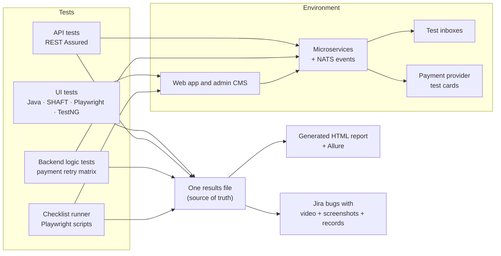

# World Surf League – QA Case Study

**Role:** Software Test Engineer (contract, through Tutanic) · **Since:** June 2026
**Product:** World Surf League's athlete and competition platform: athlete registration and membership, event entry and payments, and the Tour Manager tools used to run seasons and events.

> The client owns the code, test data and recordings from this work, so none of them are published here. This page describes what I did and how. To see the same approach in public code with real test videos, go to **[qa-automation-framework-demo](https://github.com/khloudmousad/qa-automation-framework-demo)**.

## Results in numbers

| | |
|---|---|
| **473** manual test cases | Athlete Registration (244) and Tour Manager (229), with **500+** test scenarios and traceability matrices |
| **150+** automated tests | Java, 20 test classes, 23 page objects |
| **800+** checks run | Across 15 feature areas, including 3 browser engines and responsive layouts |
| **100+** bugs reported | Over half rated High or Highest priority, each with a video, screenshots and the records involved |
| **3** test plans | Multi-platform QA (9 platforms), MySQL 8.4 database migration, data-warehouse cluster resize |

## What I tested

| Area | What I covered |
|---|---|
| Athlete registration | Account creation, age gate, adult and junior flows, guardian consent for minors (COPPA), multiple athletes per account |
| Membership and eligibility | Membership tiers, upgrades, eligibility rules for event entry |
| Event entry | Browsing events, entering, waitlists, withdrawals, confirmations, insurance |
| Payments | Card payments, declined cards, automatic payment retries and recovery reminders, refunds, invoices |
| Tour Manager | Seasons, events, settings, fields and rosters, seeding, heats, results, entry fees, role-based access |
| Athlete support | Support tickets, replies and file-upload limits |
| AI assistants | Answer accuracy benchmarks, concurrent sessions, streaming responses, navigation actions |
| Email | Verification, consent and payment emails checked in real inboxes |
| Cross-browser and responsive | Chromium, Firefox and WebKit (Safari), plus phone, tablet and desktop layouts |
| Performance and infrastructure | Browser performance reports, autoscaling checks, database migration and cluster resize testing |

## How the test automation works

- **Suites by risk.** Every test is listed once in a registry and tagged into *smoke* (critical path, every deploy), *regression* and *full* suites. You can run a suite for the whole product or for one feature area.
- **Page Object Model** for every registration and Tour Manager screen.
- **Real email checks.** A pool of test inboxes, one per new account, so verification, guardian-consent and payment emails are read and their links followed.
- **Payment testing** with the payment provider's test cards. This covered successful payments, every decline type, retries over time and refunds.
- **Local environment.** I ran the microservices locally in Docker to reproduce bugs and trace NATS events between services. I also read AWS logs to find root causes.
- **One source of truth for results.** Every run is merged into one results file, and the HTML report is generated from it, never edited by hand. Removed or changed tests are recorded.
- **Evidence standard.** Every bug includes a screen recording, screenshots, the expected and actual behaviour, and the data records involved, so developers can reproduce it on the first try.

## Manual testing and documentation

- **Use-case reviews.** Reviewed the registration and Tour Manager requirements, logged conflicts, gaps and open questions, and took them to Product for decisions.
- **Test case sheets.** Wrote test scenarios, test cases and steps, with a traceability matrix, coverage summary, blocked and missing requirements, and a requirement change log.
- **Test plans.** Wrote a multi-platform plan (web, API, Android, iOS, Apple Watch, tvOS, Fire TV, Roku, Samsung TV), a MySQL 8.4 migration plan and a data-warehouse resize plan.
- **Release support.** Retested bugs marked ready for QA, tracked stakeholder feedback, and produced release reports and demo videos for the business.

## Tools

**Automation:** Java, SHAFT Engine, Playwright, TestNG, REST Assured, Maven, Allure, Node.js scripts, pytest
**Management:** Jira, Confluence, TestCollab, Google Sheets
**Infrastructure:** Docker, AWS (logs, EKS, CloudShell), NATS, MySQL, GitHub

---
Kholoud Mousad · Software Test Engineer · [GitHub](https://github.com/khloudmousad)
